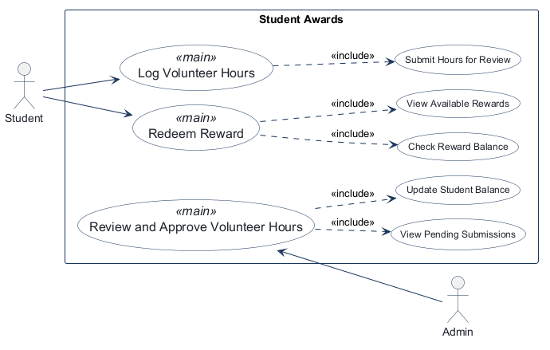
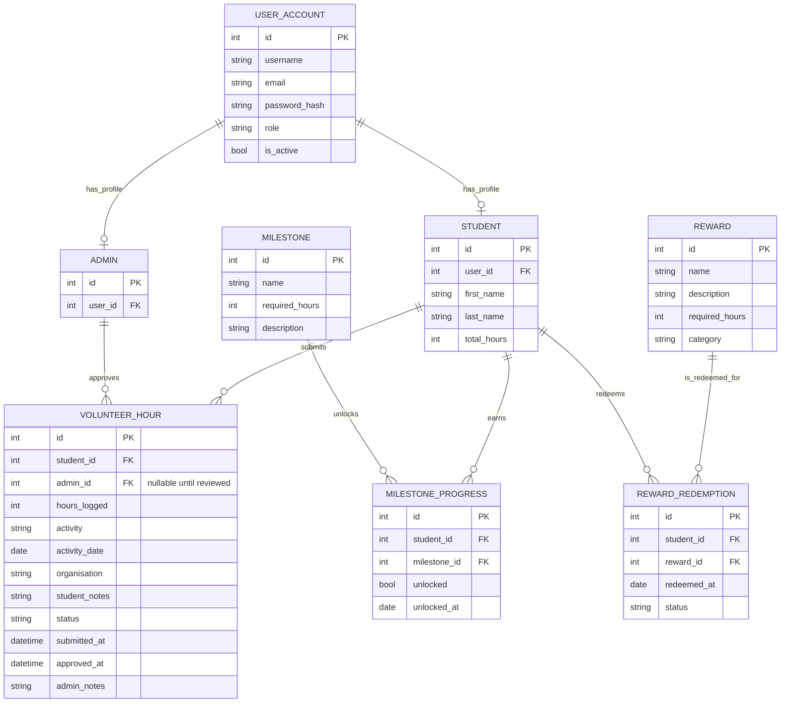

# COMP 3613 Assignment 1

Draft this file with the Guide. **Update it after every phase milestone** before you pause. The use-case diagram is a UML PNG at `docs/diagrams/use-case.png`, linked from this file as `diagrams/use-case.png` (path relative to `docs/report.md`). The model diagram is Mermaid. **Embed wireframe images** as `wireframes/<file>` (files live in `docs/wireframes/`).

Do not put your student ID in this file if you will commit it. The PDF cover adds your name and ID at export time.

## Assigned project

Student Awards

## Three workflows

### 1. Log Volunteer hours (Student)

### 2. Review and approve volunteer hours (Admin)

### 3. Redeem reward (Student)

## Use case diagram

## Model diagram

First draft. Update this section in Phase 5 when polish revises the model, and note what changed.

Draft assumptions: the core Student Awards MVP is built around students logging hours, admins approving them, rewards being redeemed once enough hours are earned, and milestones tracking progression toward higher award tiers. The starter `User` account remains the authentication identity; each student and admin has a linked domain profile. Volunteer-hour `status` handles pending / approved / rejected; a redemption records each claim as a separate event.

## Wireframes

### Student Awards Wireframe

Phase 4 model read-through and accepted revisions:
- VOLUNTEER_HOUR.hours_logged — seen on the Log Volunteer Hours form; this should be numeric and tied to the student’s submitted hours.
- VOLUNTEER_HOUR.status — seen on the admin approval board and the student dashboard tabs; keep pending / approved / rejected as the lifecycle states.
- VOLUNTEER_HOUR.notes — seen on the admin approval detail card; this should be stored with the hour submission for rejection feedback.
- REWARD_REDEMPTION.status — seen on the redemption confirmation modal; keep a status for requested / approved / denied or completed.
- MILESTONE_PROGRESS.unlocked / unlocked_at — implied by the dashboard milestone cards and the progress ring; set these as a derived state once the student meets the required hours.

<!-- student-build:wireframe-coverage
use_case: Log Volunteer Hours
image: docs/wireframes/PROJECT WIREFRAME .png
covered: yes
-->

<!-- student-build:wireframe-coverage
use_case: Review and Approve Volunteer Hours
image: docs/wireframes/PROJECT WIREFRAME .png
covered: yes
-->

<!-- student-build:wireframe-coverage
use_case: Redeem Reward
image: docs/wireframes/PROJECT WIREFRAME .png
covered: yes
-->

## Theming

Warm cream and off-white palette with muted sage, warm brown, terracotta, dusty gold, and charcoal accents; cozy student-community tone; Fraunces display type paired with Nunito body type; and a ladder with a mini student climbing above the “Student Awards” wordmark. Shared styling applies across the landing page, authentication, and authenticated application.

## Implementation notes

One named workflow at a time. Include verify notes and polish / model revisions (Phase 5). Do not treat the first build as final.

### Theming milestone

- Applied the Student Awards warm pastel palette and cozy visual identity to landing, login, register, and the authenticated shell.
- Added the ladder-and-student logo mark and replaced the starter brand/copy on the public and authentication screens.
- Refreshed the shared visual system with warm cream surfaces, earthy accents, gentle layered shadows, larger friendly headings, rounded and comfortable form controls, lighter tables, and simple welcoming navigation. Reused shared styles across the landing, login/register, student dashboard, log-hours, leaderboard, rewards, admin dashboard, and review pages.
- Added a prominent dashboard progress indicator from existing milestone summary data; styled milestone tiers and reward cards as celebratory variants; highlighted leaderboard ranks one through three; and standardized the Pending, Approved, Rejected, Locked, and Completed badge treatments. Only presentation classes and dashboard display markup changed; routes, submitted form fields/actions, models, and workflow logic are unchanged. Student reviewed the updated appearance and reported that it “looks good so far”; further polish can follow if specific mismatches are noticed.
- Second visual-polish pass: softened the card and control spacing, reduced shadow depth and hover movement, removed decorative gradients and glass-like navigation effects, refined button hierarchy and table density, and added shared empty-state styling. Refined progress, milestone, reward, and podium colors to use quieter solid earthy fills. Added only presentational classes and icons to the existing dashboard, forms, and empty states; form actions and fields, routes, data, and workflow logic remain unchanged. Mobile card/table padding and wrapped navigation remain responsive. Student verified the appearance and reported: “this looks great actually thank you”.

### Demo data and visual verification

- Added an idempotent demo seed for student accounts, an admin account, approved/pending/rejected volunteer-hour records, varied approved-hour totals for the leaderboard and milestones, and a claimed Bronze Badge with a remaining reward balance.
- `python manage.py seed` and the `/config` seed/reset actions now use the same demo-data routine. Seeding does not delete existing data; `python manage.py init` still drops tables by default.
- Demo logins: `bob / bobpass`, `admin / adminpass`, and `maya`, `jordan`, `alex`, `taylor` with password `studentpass`.
- Verified against the local database: the first run added 10 submissions and one reward claim; a second run added no duplicates. Service checks showed three pending reviews, Alex at rank 1 with 54 approved hours, Jordan at rank 2 with 38 hours / 28 reward points and a claimed Bronze Badge, and sample students spanning the remaining milestone and leaderboard states.

### Log Volunteer Hours — decisions before implementation

- After submission, return to the dashboard and show the new entry as pending.
- Link a Student profile to the authenticated User account. Collect first and last name during sign-up.
- Store Activity and Organisation separately; the wireframe's student form needs an Activity field added in the implementation while keeping Organisation.
- Revised the model to include wireframe fields for activity, activity date, organisation, student notes, and admin notes. `admin_id` is nullable until review.
- Student and Admin profiles link to the starter User identity. The student profile snippet matches the ERD; the VolunteerHour fields were completed with a nullable reviewer and pending status.
- The route delegates without inline SQL and redirects to `/app` after submission. The repository query and insert snippets are implemented. The service now validates positive hours and looks up the Student profile before using its ID. Dashboard display and success feedback are wired; sign-up collects profile names, and the demo seed creates a Student profile for regular users that do not already have one.

<!-- student-build:code-check
workflow: Log Volunteer Hours
form: choice
layer: other
architecture_ok: yes
implement_confidence: 0.82
passed: yes
note: Chose redirect to dashboard with a new pending submission.
-->

<!-- student-build:code-check
workflow: Log Volunteer Hours
form: choice
layer: model
architecture_ok: yes
implement_confidence: 0.82
passed: yes
note: Chose a Student profile linked to the authenticated User account.
-->

<!-- student-build:code-check
workflow: Log Volunteer Hours
form: choice
layer: model
architecture_ok: yes
implement_confidence: 0.82
passed: yes
note: Chose separate Activity and Organisation values.
-->

<!-- student-build:code-check
workflow: Log Volunteer Hours
form: choice
layer: other
architecture_ok: yes
implement_confidence: 0.82
passed: yes
note: Chose to collect first and last name during sign-up.
-->

<!-- student-build:code-check
workflow: Log Volunteer Hours
form: mcq
layer: service
architecture_ok: yes
implement_confidence: 0.68
passed: yes
note: Correctly placed the zero-hours acceptance decision in the service layer.
-->

<!-- student-build:code-check
workflow: Log Volunteer Hours
form: snippet
layer: model
architecture_ok: yes
implement_confidence: 0.68
passed: yes
note: Completed VolunteerHour fields from the ERD; reviewer nullable and pending status are represented.
-->

<!-- student-build:code-check
workflow: Log Volunteer Hours
form: snippet
layer: router
architecture_ok: yes
implement_confidence: 0.68
passed: yes
note: Thin handler delegates to the service, redirects to the dashboard, and surfaces validation feedback.
-->

<!-- student-build:code-check
workflow: Log Volunteer Hours
form: snippet
layer: repository
architecture_ok: yes
implement_confidence: 0.68
passed: yes
note: Implemented Student lookup by account and VolunteerHour persistence in the repository.
-->

<!-- student-build:code-check
workflow: Log Volunteer Hours
form: snippet
layer: service
architecture_ok: yes
implement_confidence: 0.68
passed: yes
note: Validates positive hours and resolves the Student profile from the authenticated account before creating the submission.
-->

### Log Volunteer Hours — implementation milestone

- Completed the Student profile lookup and VolunteerHour persistence methods in the repository, and positive-hours / profile checks in the service.
- Added sign-up fields for first and last name and create a linked Student profile; demo regular users receive a profile during `python manage.py init`.
- Built the dashboard submission form and recent submissions list, including approved-hour totals and pending counts. Successful submit flashes a pending-review message and redirects to the dashboard.
- Registration now handles duplicate-account integrity errors specifically so unrelated profile-creation failures are not reported as duplicate usernames/emails.
- Student's first `python manage.py init --no-drop` attempt created the tables but stopped during demo-user seeding because the active terminal interpreter could not import `jwt` (`ModuleNotFoundError`). `pyjwt==2.14.0` is already declared in `requirements.txt`. Student subsequently confirmed that the app now runs and is reachable locally, but says the dashboard layout does not exactly match the wireframe; visual/workflow polish remains in progress.
- For the layout mismatch, student chose a left sidebar with separate Dashboard and Log Hours pages. Split the hours form into its own page and added sidebar navigation and active-page styling. Student requested removing the Pending submissions card and showing Rewards balance and Leaderboard rank. Balance rule: approved volunteer hours minus required-hour costs of approved/completed reward redemptions.
- Updated the Dashboard metric cards to Total hours, Rewards balance, and Leaderboard rank; ranking is based on approved volunteer hours, with equal totals sharing a rank. Added Reward and RewardRedemption tables from the ERD so the rewards balance can account for approved/completed redemptions. Student verification of this polish update is pending.
- Student requested removing the duplicate dashboard “Log volunteer hours” button and adding three milestone thresholds: Bronze Badge at 10 approved hours, Department Mug at 25, and Department Shirt at 50. Dashboard now shows milestone progress cards, and the default catalog is ensured during seeding; milestones unlock as approved-hour totals reach their threshold.
- Student reports Rewards and Leaderboards were missing from the sidebar. Requested a Rewards page listing all claimed rewards, each with a distinct warm pastel border, and a Leaderboard showing every student ranked by approved hours. Added both navigation links and a leaderboard page, ordered by approved hours with shared ranks for ties and a highlight on the signed-in student. Added the claimed-rewards page/card styling and read path; final page wiring is waiting on the two student snippets below. Local verification of these changes is pending.
- Student requested a current rewards-balance display and available rewards filtered by the remaining point balance. Chose to complete a reward immediately on confirmation and deduct its point cost. Rewards page now displays the balance, cards for only affordable rewards, a confirmation modal, and the full claimed-rewards collection; service validates current balance and repository records a Completed redemption. Bronze Badge (10 points), Department Mug (25), and Department Shirt (50) are included in the default rewards catalog. Run `python manage.py init --no-drop` to seed a newly added Bronze Badge reward into an existing database. Student verification remains pending.
- Student identified that the admin area was empty and specified a pending-submission dashboard, a review page containing all activity details and the student's current approved-hour total, and approve/reject actions at the bottom. Rejection requires admin notes. Added the pending queue and review detail screens, service/repository support, admin-specific sidebar navigation, and default Admin profile seeding. Remaining student snippets: complete the VolunteerHour review fields and the thin approve/reject route handler. Local verification is pending.
- Admin review fix: the route now passes the review service's required `admin_user_id` keyword (it previously passed `admin_id`, preventing either decision from completing). Feedback now branches on the status returned by the service, so approvals no longer show a rejection message; approve and reject both show a success alert after redirecting to the admin queue, while validation errors use a danger alert.

<!-- student-build:code-check
workflow: Review and Approve Volunteer Hours
form: choice
layer: other
architecture_ok: yes
implement_confidence: 0.76
passed: yes
note: Student chose to require notes when rejecting a volunteer-hour submission.
-->

<!-- student-build:code-check
workflow: Review and Approve Volunteer Hours
form: mcq
layer: service
architecture_ok: yes
implement_confidence: 0.76
passed: yes
note: Correctly chose the service layer to coordinate approve/reject decisions.
-->

<!-- student-build:code-check
workflow: Review and Approve Volunteer Hours
form: snippet
layer: model
architecture_ok: yes
implement_confidence: 0.76
passed: pending
note: VolunteerHour review fields are scaffolded for completion in the model.
-->

<!-- student-build:code-check
workflow: Review and Approve Volunteer Hours
form: snippet
layer: router
architecture_ok: yes
implement_confidence: 0.76
passed: pending
note: Approve/reject endpoint is scaffolded for a thin service-calling route.
-->
- Removed the decorative subtext above the Rewards, Available to claim, and Claimed rewards headings at the student's request.

<!-- student-build:code-check
workflow: Leaderboard view
form: choice
layer: other
architecture_ok: yes
implement_confidence: 0.82
passed: yes
note: Student chose to show every student ranked by approved volunteer hours.
-->

<!-- student-build:code-check
workflow: Redeem reward
form: snippet
layer: model
architecture_ok: yes
implement_confidence: 0.82
passed: yes
note: Added student_id, reward_id, redeemed_at, and status to RewardRedemption from the ERD.
-->

<!-- student-build:code-check
workflow: Redeem reward
form: snippet
layer: router
architecture_ok: yes
implement_confidence: 0.82
passed: yes
note: Thin route loads claimed rewards through the service and renders the rewards page.
-->

- Rewards route and page now use the same `rewards.html` template name. Student's Student Awards workflow remains pending local verification of navigation, leaderboard ordering, claimed-rewards rendering, and pastel borders.

## Deployed app

Phase 6. Public Render URL (not localhost). Markers open this to mark the three workflows.

https://faststarter-web.onrender.com

Health check verification: `GET /health` returned HTTP 200 with `{"ok":true}`.

## Logins

Every account a marker needs, including extra users you added. Starter accounts:

- bob / bobpass — regular user
- admin / adminpass — admin
- maya / studentpass — regular user
- jordan / studentpass — regular user
- alex / studentpass — regular user
- taylor / studentpass — regular user

## YouTube URL

## Session transcripts

Filled when the Guide builds the report: the agent writes each Guide chat to `docs/transcripts/<slug>.md` (Copilot Agent, Cursor, or OpenCode). `python manage.py report` packages them. Do not paste chats here during the build.

## Competency (student-judge)

Filled when the report is built. Guide runs student-judge, writes `docs/judge.md`, and export appends the scorecard here.

## Skill integrity

Filled by `python manage.py report`. Do not edit the course skills.
